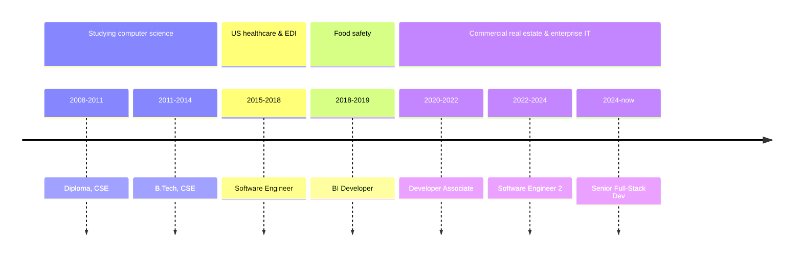

<!-- Generated from data/profile.json by build.py. Edits here are
     overwritten on the next build - change the data instead. -->

<picture>
  <source media="(prefers-color-scheme: dark)" srcset="banner-dark.svg">
  
</picture>

# Prasanna Allu

**Senior Full-Stack Developer & Technical Lead** at JLL Technologies (Centre of Excellence), Bangalore, India.

> Eleven years of finding the manual thing and quietly making it run itself.

**[The long version, with the working out →](https://allubalu.github.io/)**  ·  [LinkedIn](https://www.linkedin.com/in/prasanna-allu-7227066b/)  ·  [allubalu3@live.com](mailto:allubalu3@live.com)

---

## What that has meant

The work has always been to notice that, and then take it away. Claims cleared by rules instead of clerks. Audits on a phone instead of a clipboard. Approvals that stop living in someone's inbox. Logs anyone can read at 2am without waking me up.

These days it is my own team's busywork on the list. A bot that reads pull requests before we do, and an MCP server that has read the documentation so nobody has to ask me.

| Years shipping | Apps integrated | Requests / day | Awards | Industries |
| ---: | ---: | ---: | ---: | ---: |
| **11** | **150+** | **2M+** | **6** | **4** |

2M+ requests / day, at sub-200ms latency · industries: health, food, property, IT

<b>The same thing in CV language</b>

 

> Senior Full-Stack Developer and Technical Lead with 11 years' experience building production-grade, AI-augmented systems on Microsoft Azure, including APIs serving 2M+ requests/day at sub-200ms latency. Core strength is production readiness: reliability, observability and security at scale, paired with hands-on delivery of agentic AI tooling in real engineering workflows.

---

## The route

The banner draws the same years to scale; this names the posts.

---

## Public code

**[mcp-rbac-demo](https://github.com/allubalu/mcp-rbac-demo)** — C#  
An MCP server where authorisation is enforced per tool call, not per session. Built on the official C# SDK to find out where the protocol puts the seam between a model and a permission.

**[registry-payments](https://github.com/allubalu/registry-payments)** — TypeScript  
A payments domain layer with no framework in it: money as bigint, each jurisdiction's rules as a data pack rather than a branch, 360 tests. Adding a country is a config file, which was the whole point.

The rest of what is public here is older - tutorials and assessments from 2019-2021, kept because deleting your own learning is a strange thing to do.

### Why it is quiet here

Eleven years of this work sits in private repositories at two employers: a claims engine, an audit app that replaced a clipboard, an access platform. What is public here is deliberate and small, roughly one repository per technique I wanted to be able to point at. A contribution graph measures the open-source half of a career. Mine has mostly been the other half.

---

## Stack, by the year it started

| Since | |
| :--- | :--- |
| `2015` | C# & .NET · SQL Server & relational data |
| `2018` | Tableau & Power BI |
| `2020` | Microsoft Azure |
| `2022` | Datadog & Splunk · Kafka & event-driven design |
| `2024` | Agentic AI (MCP, Claude, CrewAI) · React |

Years in production, not self-rated proficiency.

---

## Recognition

6 awards, all at JLL.

| | |
| :--- | :--- |
| **Security Champion** | Apr 2026 · nominated by the Vice President and Chief Architect |
| **Domain Expertise & Adaptability** | Sep 2025 |
| **TAT UI Go Live** | Sep 2025 |
| **Subject Matter Expert: Datadog** | Oct 2024 |
| **JLLT Technology Engineering Award** | Jan 2024 |
| **Certificate of Appreciation** | Sep 2020 |

---

## Credentials

| | Issuer | |
| :--- | :--- | :--- |
| EF SET English Certificate: C1 Advanced | EF SET | Jul 2026 |
| Agentic AI | DeepLearning.AI | Jul 2026 |
| Microsoft Certified: Azure Developer Associate | Microsoft | **expired Jan 2026** |
| Cloud Architect certification | — | _in progress_ |
| Microsoft India App Fest | Microsoft India | 2013 |

---

Every figure here is read from one source file. Impact percentages are self-reported and unaudited; ask, and I will explain how each was measured. A few entries are stated from memory rather than a certificate. Drawings are original.

The rest of it — the projects, the people I worked with, where the habit started — is at **[allubalu.github.io](https://allubalu.github.io/)**.

There is always another manual thing. If yours has a name, I would like to hear it.
